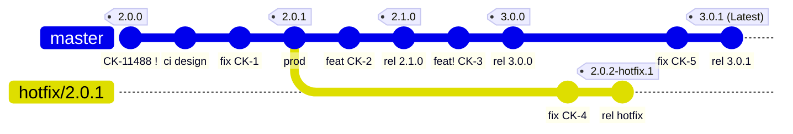
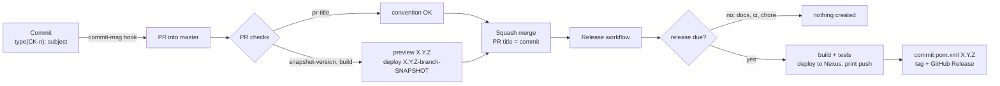
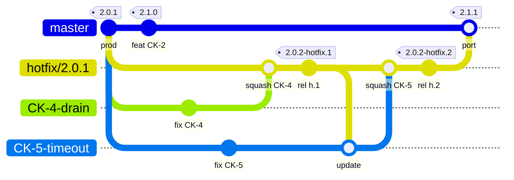
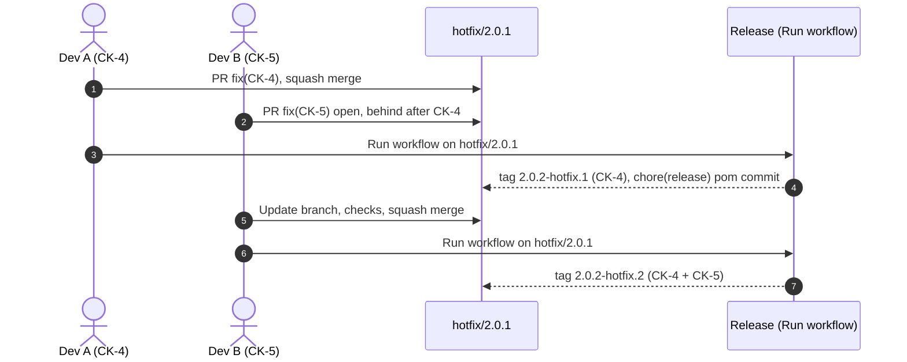

# homelab-poc-semantic-version

POC of a release flow on a two-module Java 25 / Spring Boot 4 hello world: **the version is a consequence of what
is merged**. [semantic-release](https://semantic-release.gitbook.io/) calculates it from
[Conventional Commits](https://www.conventionalcommits.org/en/v1.0.0/). Git tags, GitHub Releases, the release
commit of the `pom.xml` files and the Maven deploy to a Nexus started with docker compose are real; docker pushes
are printed as `[dry-run]` lines.

| Module | Packaging | Content |
| --- | --- | --- |
| `homelab-poc-semantic-version` (root) | `pom` | parent and aggregator: version, `distributionManagement` |
| `hello-lib` | `jar` | `GreetingService`, plain Java |
| `hello-service` | Spring Boot `jar` | `GET /hello` returns `helloworld`, `/actuator/info`, OpenAPI; docker image |

The flow mirrors [cnr-semantic-release-poc](https://github.com/cinarra/cnr-semantic-release-poc) (same `.github`
layout, workflows, scripts and conventions); only names, modules, runners and the real Nexus deploy differ.

## Scenario

Tags `1.0.0` and `2.0.0` were released by an earlier design of this repository. The scenario below is the plan for
the first runs of this design; the evidence (PRs, runs, releases) goes to [`.github/e2e/`](.github/e2e/) as the
steps are executed.

**Scenario:** production runs **`2.0.1`**, while `master` already moved to `2.1.0` and `3.0.0`. A production bug
must be fixed on `2.0.1` **without** shipping the unvalidated changes of `2.1.0` or `3.0.0`, so the hotfix branch
is cut from tag `2.0.1`. `rel X` stands for the `chore(release): X [skip ci]` commit of the `pom.xml` files.



| Step | What | Result |
| --- | --- | --- |
| 1 | PR `fix(CK-1)` | `2.0.1` (patch), the version **in production** |
| 2 | PR `feat(CK-2)` | `2.1.0` (minor) |
| 3 | PR `feat(CK-3)!` | `3.0.0` (major) |
| 4 | PR `docs(CK-6)` | no release |
| 5 | hotfix PR `hotfix/2.0.1` → `master`, **kept open** | snapshot `3.0.1-hotfix-2.0.1-SNAPSHOT` |
| 6 | Run workflow **Release** on `hotfix/2.0.1` (`dry_run`, then real) | `2.0.2-hotfix.1`, Pre-release; Latest unchanged |
| 7 | PR `fix(CK-5)` | `3.0.1` (Latest) + `chore(release): 3.0.1` commit of the `pom.xml` files |

Where to look: [releases](https://github.com/avall/homelab-poc-semantic-version/releases) (Latest vs Pre-release),
the run **summary** (versions, artifacts deployed to Nexus, docker tags), and the logs (`versions:set` diff, Nexus
search, `[dry-run]` push lines).

## How releases work



1. **Commit** `<type>(CK-<number>)[!]: <subject>`, enforced by a local hook and the `pr-title` check (only the PR title reaches `master`).
2. **PR checks**: title convention, a preview of the version the PR will release, and a build that
   deploys `<next>-<branch>-SNAPSHOT` to the Nexus of the job.
3. **Squash merge**: the PR title is the commit that decides the bump.
4. **Release** (one job): calculate version → build, test and deploy to Nexus → docker image → commit the
   `pom.xml` files, tag, GitHub Release. The tag comes last, so a failed build never leaves one behind.

| PR title type | Bump | Example |
| --- | --- | --- |
| `fix`, `perf`, `revert` | patch | `2.0.0` → `2.0.1` |
| `feat` | minor | `2.0.1` → `2.1.0` |
| `!` after the scope in the PR title (a `BREAKING CHANGE:` footer in the PR description is dropped by the blank squash body) | major | `2.1.0` → `3.0.0` |
| `docs`, `ci`, `chore`, `test`, `build`, `refactor` | none | — |

### POM version

`versions:set` (the `versions-maven-plugin`, with `-DprocessAllModules=true`) updates the root `pom.xml` and the
parent version of both modules:

| When | `pom.xml` version | Committed | Nexus repository |
| --- | --- | --- | --- |
| PR build | `<next>-<branch>-SNAPSHOT` | no, CI workspace only | `maven-snapshots` |
| Release from `master` | `X.Y.Z` | yes, `chore(release): X.Y.Z [skip ci]` | `maven-releases` |
| Hotfix release | `X.Y.(Z+1)-hotfix.N` | yes, on the hotfix branch | `maven-releases` |
| Local build | last release, as in git | — | only with `-s <settings> deploy` |

The branch keeps parallel PRs apart (two PRs releasing `2.1.0` never overwrite each other). No `-SNAPSHOT` is
ever committed. Never consume `LATEST`, `RELEASE`, version ranges or docker `latest` in production: Nexus
`maven-metadata.xml` reflects the last **deployed** version and docker tags have no order. Pin exact versions;
the git tags are the source of truth.

### What changes in each case

The tables start from the scenario above. Nexus holds the parent `homelab-poc-semantic-version` pom too; the
image is `ghcr.io/avall/homelab-poc-semantic-version`, built from `hello-service` only; its pushes are printed,
not executed. A PR build tags the image `<snapshot>` and `<snapshot>-oci`.

**Patch** — PR `fix(CK-1): ...` from branch `CK-1-fix`, merged on `master` (last release `2.0.0`):

| Item | Before | PR build | After the release |
| --- | --- | --- | --- |
| `pom.xml` in git (root, both modules) | `2.0.0` | `2.0.0` | `2.0.1` (`chore(release): 2.0.1 [skip ci]`) |
| `pom.xml` in CI | — | `2.0.1-CK-1-fix-SNAPSHOT` | `2.0.1` |
| Nexus `hello-lib`, `hello-service` | — | `maven-snapshots` `2.0.1-CK-1-fix-SNAPSHOT` | `maven-releases` `2.0.1` |
| Image tags | — | `2.0.1-CK-1-fix-SNAPSHOT` | `2.0.1`, `2.0.1-oci`, `latest` |
| Git tag / GitHub Release | `2.0.0` | — | `2.0.1`, Latest |

**Minor** — PR `feat(CK-2): ...` from branch `CK-2-feat` (last release `2.0.1`):

| Item | Before | PR build | After the release |
| --- | --- | --- | --- |
| `pom.xml` in git | `2.0.1` | `2.0.1` | `2.1.0` |
| `pom.xml` in CI | — | `2.1.0-CK-2-feat-SNAPSHOT` | `2.1.0` |
| Nexus `hello-lib`, `hello-service` | `maven-releases` `2.0.1` | `maven-snapshots` `2.1.0-CK-2-feat-SNAPSHOT` | `maven-releases` `2.1.0` |
| Image tags | `2.0.1`, `latest` | `2.1.0-CK-2-feat-SNAPSHOT` | `2.1.0`, `2.1.0-oci`, `latest` |
| Git tag / GitHub Release | `2.0.1` | — | `2.1.0`, Latest |

**Major** — PR `feat(CK-3)!: ...` from branch `CK-3-break` (last release `2.1.0`):

| Item | Before | PR build | After the release |
| --- | --- | --- | --- |
| `pom.xml` in git | `2.1.0` | `2.1.0` | `3.0.0` |
| `pom.xml` in CI | — | `3.0.0-CK-3-break-SNAPSHOT` | `3.0.0` |
| Nexus `hello-lib`, `hello-service` | `maven-releases` `2.1.0` | `maven-snapshots` `3.0.0-CK-3-break-SNAPSHOT` | `maven-releases` `3.0.0` |
| Image tags | `2.1.0`, `latest` | `3.0.0-CK-3-break-SNAPSHOT` | `3.0.0`, `3.0.0-oci`, `latest` |
| Git tag / GitHub Release | `2.1.0` | — | `3.0.0`, Latest |

**PR without release** — PR `docs(CK-6): ...` from branch `CK-6-docs` (last release `3.0.0`): the build uses `3.0.0-CK-6-docs-SNAPSHOT`
(last release plus branch), deploys it to `maven-snapshots`, and the merge creates nothing: no commit, tag,
release or Nexus release.

**Hotfix** — `hotfix/2.0.1` cut from tag `2.0.1`, `fix(CK-4)` pushed, Run workflow **Release** on it:

| Item | Before | Hotfix PR into `master` | After Run workflow |
| --- | --- | --- | --- |
| `pom.xml` in git (`hotfix/2.0.1`) | `2.0.1` | `2.0.1` | `2.0.2-hotfix.1` (`chore(release)` on the hotfix branch) |
| `pom.xml` in git (`master`) | `3.0.0` | `3.0.0` | `3.0.0` (until the PR is merged) |
| `pom.xml` in CI | — | `3.0.1-hotfix-2.0.1-SNAPSHOT` | `2.0.2-hotfix.1` |
| Nexus `hello-lib`, `hello-service` | `maven-releases` `2.0.1` | `maven-snapshots` `3.0.1-hotfix-2.0.1-SNAPSHOT` | `maven-releases` `2.0.2-hotfix.1` |
| Image tags | `2.0.1` | `3.0.1-hotfix-2.0.1-SNAPSHOT` | `2.0.2-hotfix.1`, `2.0.2-hotfix.1-oci`, **no** `latest` |
| Git tag / GitHub Release | `2.0.1` | — | `2.0.2-hotfix.1`, Pre-release (Latest stays `3.0.0`) |

The Nexus of a CI job lives only as long as the job (docker compose on the runner): the tables show what each
build deploys and the step summary proves it with the Nexus search API. A shared Nexus replaces it by changing
`nexus.url` and the credentials.

## Hotfix

| | Regular release | Hotfix |
| --- | --- | --- |
| Branch | `master` | `hotfix/<production tag>`, cut from that tag |
| Version | `3.0.1` | `2.0.2-hotfix.1`, `2.0.2-hotfix.2`, ... |
| Trigger | squash merge | manual **Run workflow** of Release on the hotfix branch |
| GitHub Release | Latest | Pre-release |
| Docker `latest` | yes | no |

```bash
git fetch --tags
git switch -c hotfix/2.0.1 2.0.1                     # the version in production
git commit -am "fix(CK-4): drain in-flight requests on shutdown"
git push -u origin hotfix/2.0.1
gh pr create --base master --head hotfix/2.0.1 --title "fix(CK-4): drain in-flight requests on shutdown"
gh workflow run release.yml --ref hotfix/2.0.1 -f dry_run=true   # print only
gh workflow run release.yml --ref hotfix/2.0.1                   # 2.0.2-hotfix.1
```

Then **merge** the PR (squash: `master` releases the next patch with the fix) or **close** it (`master` is
unaffected).

Rules:

- The branch name must be `hotfix/<production tag>`; the base version is read from it.
- Patch-level changes only (`fix`, `perf`, `revert`).
- Release every hotfix before "Update branch": once `master` is merged in, hotfix releases are blocked.
- After a hotfix release the PR conflicts on the `pom.xml` versions: resolve it keeping the `master` version,
  as the last step before the merge.
- A hotfix runs the workflows as they were at its tag. Tags `1.0.0` and `2.0.0` predate this design, so they
  cannot be hotfixed with it; hotfixes start with the first tag released by this design.

### Two hotfixes at the same time on the same tag

Two production bugs on `2.0.1` (CK-4 and CK-5) are fixed in parallel. The branch name is fixed by the rule
(`hotfix/<production tag>`), so there is **one** hotfix branch, `hotfix/2.0.1`, and both fixes go into it:

1. Each developer branches from the hotfix branch and opens a PR **into `hotfix/2.0.1`**: `CK-4-drain` →
   `fix(CK-4): drain in-flight requests on shutdown`, `CK-5-timeout` → `fix(CK-5): raise the client timeout`.
   The PR checks run against the hotfix base: `snapshot-version` previews `2.0.2-hotfix.1` and `build` deploys
   `2.0.2-hotfix.1-CK-4-drain-SNAPSHOT`.
2. CK-4 is squash-merged first. **Run workflow** Release on `hotfix/2.0.1` releases `2.0.2-hotfix.1` (CK-4) and
   commits the `pom.xml` files on the hotfix branch.
3. The CK-5 PR is now behind (the squash of CK-4 and the release commit): **Update branch**, checks again, merge.
   The next Run workflow releases `2.0.2-hotfix.2` = `2.0.1` + CK-4 + CK-5. Hotfixes are cumulative.
4. Production deploys `2.0.2-hotfix.2` (it contains both fixes); `2.0.2-hotfix.1` is skipped or replaced.
5. One PR `hotfix/2.0.1` → `master` carries both fixes to `master` (after the last hotfix release, see the rules).



`prod` is the release running in production; `rel` is the `chore(release)` commit of the `pom.xml` files; `update` is the "Update branch" of the CK-5 PR; `port` is the squash of the PR `hotfix/2.0.1` → `master` with both fixes.



| Item | After CK-4 release | After CK-5 release |
| --- | --- | --- |
| `pom.xml` in git (`hotfix/2.0.1`) | `2.0.2-hotfix.1` | `2.0.2-hotfix.2` |
| Nexus `hello-lib`, `hello-service` (`maven-releases`) | `2.0.2-hotfix.1` | `2.0.2-hotfix.1`, `2.0.2-hotfix.2` |
| Image tags | `2.0.2-hotfix.1`, `2.0.2-hotfix.1-oci` | `2.0.2-hotfix.2`, `2.0.2-hotfix.2-oci` (never `latest`) |
| Git tag / GitHub Release | `2.0.2-hotfix.1`, Pre-release | `2.0.2-hotfix.2`, Pre-release (Latest stays on `master`) |

What to know:

- **No race:** the Release workflow has `concurrency: release-${{ github.ref }}` without cancellation, so two
  Run workflow on the same hotfix branch run one after the other, and semantic-release numbers them in order.
- **Release right after each merge** if each fix must get its own version; if both are merged before running the
  workflow, one run releases both as `2.0.2-hotfix.1`.
- **B without A is not possible** once A is on the branch: revert A with a `revert(CK-4): ...` PR into the hotfix
  branch, which releases the next `hotfix.N`.
- **Direct pushes** to `hotfix/2.0.1` are accepted but run no checks; with two developers, prefer PRs into the
  hotfix branch, and pull before pushing because every release adds a `chore(release)` commit there.
- **Port to `master`:** the single PR `hotfix/2.0.1` → `master` is squashed into one commit with one title, so
  name both keys in its description, or port each fix with its own cherry-pick PR.

**Why `2.0.2-hotfix.1`:** in SemVer a `-suffix` sorts before the plain version (`2.0.1-rc.1 < 2.0.1`), so
`2.0.1-hotfix.1` would look **older** than production, a plain `2.0.2` belongs to the regular `master` releases
(in the reference scenario the next patch was already taken) and would hide that it is a hotfix, and `2.0.1.1` is
not SemVer.
`2.0.1 < 2.0.2-hotfix.1 < 2.0.2` means exactly "2.0.1 plus a fix". (Maven sorts it after `2.0.2`; irrelevant for
deployed services.)

## Snapshot

Every PR into `master` or `hotfix/**` builds `<next>-<branch>-SNAPSHOT` and deploys it to `maven-snapshots`:

- `<next>` is the version the PR releases once squash-merged, from a semantic-release dry run of the base branch
  plus the future squash commit (PR title and description). A PR that does not release uses the last release.
- `<branch>` is the PR head branch with every character outside `[A-Za-z0-9.]` replaced by `-`, at most 60
  characters (`feature/CK-12_greeting` → `feature-CK-12-greeting`).
- The job runs no PR code: it checks out the base commit, so a PR cannot change the scripts that compute it.

## Version of a running service

`hello-service` stamps the version into the artifact: `spring-boot-maven-plugin` `build-info` writes
`META-INF/build-info.properties` (the `pom.xml` version set by `versions:set`) and `git-commit-id-maven-plugin`
writes `git.properties`. `/actuator/info` serves both:

```bash
curl -s localhost:8080/actuator/info
# {"git":{"branch":"master","commit":{"id":"1a2b3c4","time":"..."}},
#  "build":{"artifact":"hello-service","name":"hello-service","version":"2.0.1","group":"com.avall.poc"}}
```

## Local setup

```bash
git config core.hooksPath .github/hooks          # once per clone: commit-msg check
./mvnw clean verify                              # unit (*Test) + integration (*IT) tests, both modules
./mvnw -q install -DskipTests && ./mvnw -pl hello-service spring-boot:run
                                                 # http://localhost:8080/hello, /swagger-ui.html, /actuator/info
```

Deploy to a local Nexus ([`docker-compose.yml`](docker-compose.yml), `sonatype/nexus3`, port 8081, volume
`nexus-data`):

```bash
docker compose up -d                                         # first start takes 1-2 minutes
NEXUS_ACCEPT_EULA=true .github/scripts/nexus-up.sh           # waits, writes target/nexus-settings.xml
./mvnw -s target/nexus-settings.xml deploy                   # current version: maven-releases
./mvnw versions:set -DnewVersion=2.0.1-local-SNAPSHOT -DgenerateBackupPoms=false -DprocessAllModules=true
./mvnw -s target/nexus-settings.xml deploy                   # maven-snapshots
git checkout -- pom.xml '**/pom.xml'                         # back to the committed version
docker compose down -v                                       # stop and wipe Nexus
```

- `nexus-up.sh` reads the generated admin password from `/nexus-data/admin.password` and writes a
  `settings.xml` with the server ids `nexus-releases` and `nexus-snapshots` of `distributionManagement`. Never
  commit it. Run it again after `./mvnw clean` (it is idempotent); set `NEXUS_PASSWORD` once the password was
  changed in the UI.
- Nexus Community Edition rejects uploads (HTTP 403) until its
  [EULA](https://links.sonatype.com/products/nxrm/ce-eula) is accepted. `NEXUS_ACCEPT_EULA=true` accepts it
  through the REST API; the workflows set it.
- `maven-releases` accepts a release version once: redeploying the same `X.Y.Z` fails until the volume is wiped.
- UI at <http://localhost:8081> (user `admin`).

## Repository settings

- **Pull requests**: allow squash merging only, default commit message "Pull request title" (title = PR title,
  blank body); the PR title decides the bump. The snapshot preview also reads the PR description, so keep breaking
  changes in the title (`!`).
- **Ruleset `master`**: require a pull request (squash only); required status checks `pr-title` and `build`
  (`snapshot-version` runs on every PR but is not required); "up to date" off; block force pushes and deletion.
- **Release commit bypass**: the release pushes `chore(release): X.Y.Z [skip ci]` to `master` with the secret
  `PUSH_TO_PROTECTED_BRANCH`. For a personal repository it is a fine-grained PAT of the owner (Contents: read and
  write on this repository), and the **Repository admin** role is in the `master` ruleset bypass list.
  `[skip ci]` keeps the commit from starting another run.
- **`hotfix/**`**: no pull request rule, direct pushes accepted (the hotfix release commits its `pom.xml` there).
- **Ruleset for tags** (all tags): restrict updates and deletions, so a released version never moves. GitHub
  [immutable releases](https://docs.github.com/en/code-security/supply-chain-security/understanding-your-software-supply-chain/immutable-releases)
  add the same guarantee to release assets.

| Workflow | Trigger | Jobs |
| --- | --- | --- |
| `pr-conventions.yml` | PR into `master` / `hotfix/**` | `pr-title` |
| `ci.yml` | PR into `master` / `hotfix/**` | `snapshot-version`, `build` |
| `release.yml` | push to `master`, or Run workflow on `master` / `hotfix/X.Y.Z` (`dry_run`) | `semantic-release` |

- Composite steps live in `.github/actions/`, config in `.github/release/releaserc.json`, scripts and the
  commit hook in `.github/scripts/` and `.github/hooks/`.
- Jobs run on GitHub-hosted `ubuntu-latest` runners; actions are referenced by version tag.
- semantic-release `25.0.9` with `conventional-changelog-conventionalcommits@9.3.1` (10.x needs a newer
  changelog writer than semantic-release 25 bundles) and `@semantic-release/git@11.0.1`.

## References

Standards and tools:

- [Semantic Versioning 2.0.0](https://semver.org/) — precedence of pre-release versions (`2.0.2-hotfix.1 < 2.0.2`).
- [Conventional Commits 1.0.0](https://www.conventionalcommits.org/en/v1.0.0/).
- semantic-release: [docs](https://semantic-release.gitbook.io/semantic-release/),
  [workflow configuration](https://semantic-release.gitbook.io/semantic-release/usage/workflow-configuration)
  (release and pre-release branches), [FAQ](https://semantic-release.gitbook.io/semantic-release/support/faq),
  [@semantic-release/git](https://github.com/semantic-release/git).
- [action-semantic-pull-request](https://github.com/amannn/action-semantic-pull-request) (PR title check).
- Maven: [versions:set](https://www.mojohaus.org/versions/versions-maven-plugin/set-mojo.html),
  [maven-deploy-plugin](https://maven.apache.org/plugins/maven-deploy-plugin/).
- Sonatype Nexus Repository: [Maven repositories](https://help.sonatype.com/en/maven-repositories.html),
  [search API](https://help.sonatype.com/en/search-api.html),
  [Community Edition onboarding](https://links.sonatype.com/products/nxrm3/docs/ce-onboarding),
  [docker image](https://hub.docker.com/r/sonatype/nexus3).
- Spring Boot: [actuator endpoints (`info`)](https://docs.spring.io/spring-boot/reference/actuator/endpoints.html),
  [build-info goal](https://docs.spring.io/spring-boot/maven-plugin/build-info.html),
  [git-commit-id-maven-plugin](https://github.com/git-commit-id/git-commit-id-maven-plugin).

GitHub:

- [Rulesets](https://docs.github.com/en/repositories/configuring-branches-and-merges-in-your-repository/managing-rulesets/about-rulesets)
  and [squash merge settings](https://docs.github.com/en/repositories/configuring-branches-and-merges-in-your-repository/configuring-pull-request-merges/configuring-commit-squashing-for-pull-requests).
- [Immutable releases](https://docs.github.com/en/code-security/supply-chain-security/understanding-your-software-supply-chain/immutable-releases).
- [Secure use of GitHub Actions](https://docs.github.com/en/actions/reference/security/secure-use) and
  [`pull_request_target`](https://docs.github.com/en/actions/reference/workflows-and-actions/events-that-trigger-workflows#pull_request_target)
  (why the PR jobs use `pull_request` and run no PR code with write tokens).
- [`GITHUB_TOKEN` permissions](https://docs.github.com/en/actions/concepts/security/github_token).

Practices of large projects:

- [A successful Git branching model](https://nvie.com/posts/a-successful-git-branching-model/) (git-flow
  hotfix branches cut from the production tag).
- [Kubernetes patch releases](https://kubernetes.io/releases/patch-releases/) (fixes on release branches of
  supported versions).
- [Google SRE book: Release Engineering](https://sre.google/sre-book/release-engineering/) (hermetic,
  reproducible builds from tags; cherry-picks onto release branches).
- [Martin Fowler: Continuous Integration](https://martinfowler.com/articles/continuousIntegration.html).
