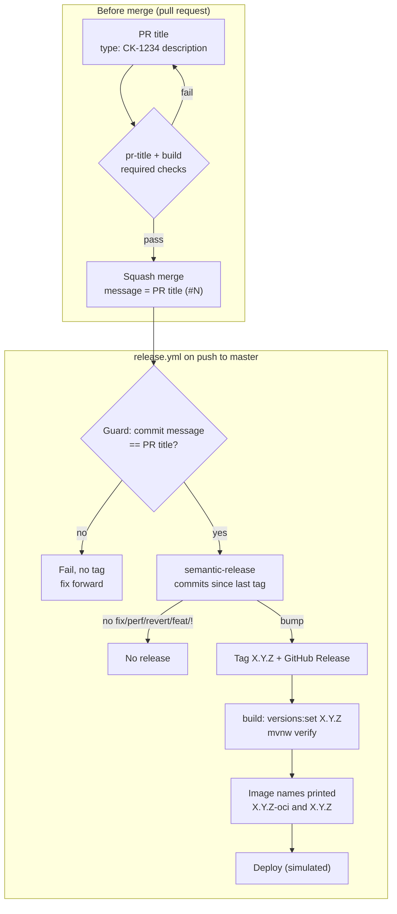
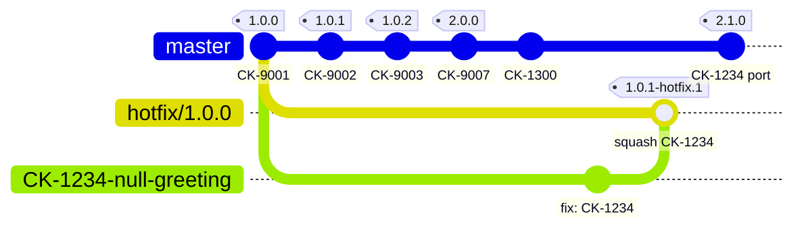
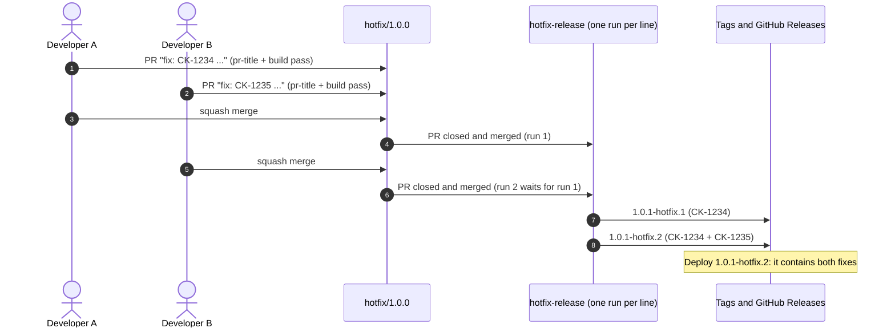
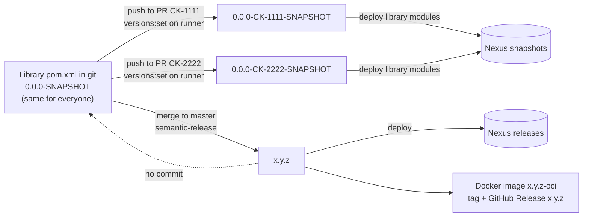
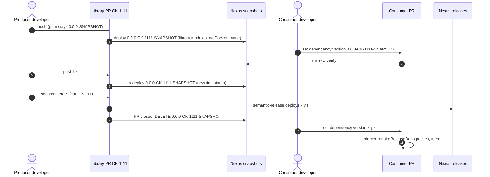
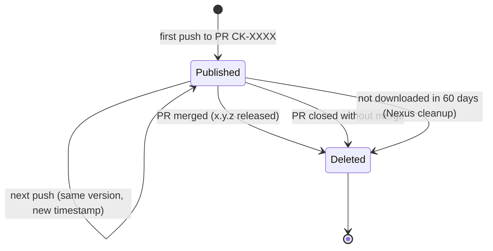

# homelab-poc-semantic-version

POC of automated releases driven by **PR titles** with [semantic-release](https://semantic-release.org/), following the proposal *Automated Releases from PR Titles with semantic-release* (`plan/semantic-version/release-automation-proposal.md`).

A Spring Boot 4 service (`GET /hello` returns `helloworld`) releases itself: the PR title decides MAJOR / MINOR / PATCH, a squash merge copies it into the only commit on `master`, a guard checks it, and semantic-release creates the tag and the GitHub Release. Maven gets the version at build time; nothing is committed back (`pom.xml` stays at `0.0.0-SNAPSHOT`).

## Rules

PR title format (validated by the `pr-title` check):

```
<type>[(scope)][!]: CK-1234 <description>
```

| Type | Use it when the PR... | Bump | Example |
|---|---|---|---|
| `fix` | corrects a bug, no contract change | PATCH | `fix(auth): CK-1234 refresh expired JWT` |
| `perf` | same result, faster | PATCH | `perf(orders): CK-1234 add index on customer_id` |
| `revert` | undoes a previous change | PATCH | `revert: CK-1234 restore 30s timeout` |
| `feat` | adds a capability clients can ignore | MINOR | `feat(reports): CK-1234 add CSV export` |
| any type + `!` | breaks clients | MAJOR | `feat(api)!: CK-1234 remove /v1/orders` |
| `docs`, `test`, `refactor`, `build`, `ci`, `chore`, `style` | no runtime change | none | `refactor: CK-1234 extract TaxService` |

- Only the title counts: the squash body is blank, so a `BREAKING CHANGE:` footer in the PR description has no effect. `!` is the only breaking signal.
- The highest bump wins when one release contains several PRs.
- The Jira key goes first in the description (`subjectPattern: ^CK-\d+ .+$`). PRs labelled `dependencies` (Dependabot) skip the check.
- Only `master` releases with semantic-release. Hotfixes for an older production version go to a hotfix line `hotfix/X.Y.Z` and release `X.Y.(Z+1)-hotfix.N` (see [Hotfixes](#hotfixes)).

## Architecture



## Hotfixes

**Scenario.** Production runs `1.0.0`. `master` already released `1.0.1`, `1.0.2` and `2.0.0`, and has unreleased commits. A bug on `1.0.0` must be fixed from tag `1.0.0` without shipping any later change. SemVer has no free number between `1.0.0` and `1.0.1` except a pre-release of `1.0.1`, so the hotfix is `1.0.1-hotfix.N`.

| What | Name | Example |
|---|---|---|
| Hotfix line (long-lived branch, created from the production tag) | `hotfix/<production tag>` | `hotfix/1.0.0` |
| Work branch (one per fix, PR into the line) | `CK-1234-description` | `CK-1234-null-greeting` |
| Hotfix versions (tags and GitHub Releases) | `X.Y.(Z+1)-hotfix.N` | `1.0.1-hotfix.1`, `1.0.1-hotfix.2` |

Flow:

1. Run the `hotfix-start` workflow (Actions > hotfix-start > Run workflow) with `base_tag` set to the production version: `1.0.0`, or a hotfix already in production such as `1.0.1-hotfix.2` (both map to `hotfix/1.0.0`). It validates the tag, creates `hotfix/1.0.0` at the tag commit or reuses it, and prints the next version.
2. Branch `CK-1234-description` from `hotfix/1.0.0` and open a PR into `hotfix/1.0.0` titled `fix: CK-1234 ...`.
3. Squash merge. `hotfix-release` computes `1.0.1-hotfix.N` (`scripts/hotfix-version.sh`), stamps it with `versions:set`, runs `./mvnw verify`, prints the image names and creates the tag and the GitHub Release.
4. Port the fix to `master` with a cherry-pick PR `fix: CK-1234 ...`. The next deployment is the `master` release that contains the port.



Two hotfixes at the same time on one line:



Rules:

- Only `fix`, `perf` and `revert` titles, without `!`, are accepted on `hotfix/**` (`pr-title` check, re-checked by `hotfix-release`).
- A hotfix is released when a PR is merged into the line, not on every push. Direct pushes are blocked by the branch ruleset.
- Hotfixes are cumulative: `1.0.1-hotfix.2` contains `1.0.1-hotfix.1`. N is the highest existing N of the line plus one.
- Hotfix lines are never deleted (ruleset `deletion` rule) while that version runs in production.
- Port every fix to `master` by cherry-pick. Never merge a hotfix line into `master`.
- After a hotfix, the next deployment is a `master` version that contains the port, never `1.0.1` or `1.0.2`: they were released before the fix and do not contain it.

Known caveats:

- SemVer orders `1.0.1-hotfix.N < 1.0.1`, although `1.0.1` does not contain the fix. Do not use version ranges to pick hotfixes.
- Maven orders `1.0.1-hotfix.10 > 1.0.1` (an unknown qualifier sorts after the release). Hotfix versions are for services, not for shared libraries that other builds resolve by range.
- The GitHub Release of a hotfix is not marked Pre-release and not Latest (`--latest=false`), so Latest stays on the `master` line.
- `hotfix-release` uses `pull_request_target`: since 2025-12-08 the workflow file always comes from the default branch, so lines cut from tags older than this workflow still release. `scripts/hotfix-version.sh` is taken from the default branch too; only the build (`mvnw`, sources) comes from the merged commit.
- GitHub keeps at most one pending run per concurrency group. If three PRs merge into one line before the first release finishes, the middle run is cancelled; the third release is cumulative and still contains its fix.

## Repository layout

| Path | Purpose |
|---|---|
| `src/` | Spring Boot app (`com.avall.poc.semver`) and its test |
| `pom.xml`, `mvnw`, `.mvn/` | Maven build (Java 25, Spring Boot 4.1.1, Maven 3.9.11 wrapper) |
| `.github/workflows/ci.yml` | `build` check on every PR |
| `.github/workflows/pr-title.yml` | `pr-title` check (amannn/action-semantic-pull-request) |
| `.github/workflows/release.yml` | guard, semantic-release, build, image names and simulated deploy (`master` only) |
| `.github/workflows/hotfix-start.yml` | manual: create or reuse the hotfix line `hotfix/<tag>` and print the next version |
| `.github/workflows/hotfix-release.yml` | on merge into `hotfix/**`: tag and GitHub Release `X.Y.(Z+1)-hotfix.N` |
| `.github/workflows/snapshot.yml` | simulated `0.0.0-CK-XXXX-SNAPSHOT` deploy on every PR push, and delete on close |
| `.releaserc.json` | branches (`master` only), `tagFormat: ${version}`, `conventionalcommits` preset |
| `.github/dependabot.yml` | Maven and Actions updates titled `build(deps): ...` |
| `.github/pull_request_template.md` | title reminder and "Breaking change?" checkbox |
| `scripts/setup-github.sh` | one-time repository settings and rulesets |
| `scripts/hotfix-version.sh`, `scripts/snapshot-version.sh` | hotfix line and version, snapshot version (no network) |
| `tests/run.sh` | table-driven tests of both scripts, run by the `build` check |
| `use-cases/` | scripts that run each scenario on GitHub ([index](use-cases/README.md)) |

## Prerequisites

- JDK 25 (the wrapper downloads Maven 3.9.11)
- `gh` authenticated with `repo` scope, `jq`, `git`
- `gh stack` extension for use case 08

## Repository setup (precondition)

The release flow only works when the repository settings and rulesets are in place. This is a **precondition for this POC and for every repository** that adopts the flow: without the rulesets, an invalid PR title can be merged, a hotfix line can be deleted or pushed to directly, and anyone can create a tag that collides with a calculated version.

**Order matters.** The required checks `build` and `pr-title` only exist once their workflows are on the default branch. `pr-title` runs on `pull_request_target`, which always takes the workflow from the default branch. So:

1. **Bootstrap the code** with a direct push to the default branch, *before* any ruleset, with `[skip ci]` so the release guard does not fail on a commit without a PR. Example: `ci: CK-1234 bootstrap release automation [skip ci]`.
2. **Open a test PR** so that `build` and `pr-title` run once (the ruleset UI suggests checks that ran recently).
3. **Apply the settings below**, in the UI or with the script.
4. **Check the protection:** a PR titled `wip` must fail `pr-title` and its merge button must be blocked.

### Settings in the GitHub UI

| Where | Setting | Value |
|---|---|---|
| Settings › General › Default branch | Rename (pencil icon) | `master` |
| Settings › General › Pull Requests | Allow merge commits | off |
| | Allow squash merging | on, default message **Pull request title** (`PR_TITLE` + `BLANK`) |
| | Allow rebase merging | off |
| | Automatically delete head branches | on (deletes `CK-...` work branches; `hotfix/*` lines are protected by the ruleset) |
| Settings › General › Releases | Enable release immutability | on |
| Settings › Actions › General | Actions permissions | allow `actions/*`, `amannn/action-semantic-pull-request`, `cycjimmy/semantic-release-action` (or all actions) |
| | Workflow permissions | read is enough: each workflow asks for `contents: write` itself |

**Settings › Rules › Rulesets › New branch ruleset** `release-branches`:

- Enforcement status: **Active**. Bypass list: empty.
- Target branches: **Include default branch** and **Include by pattern** `hotfix/*`.
- Rules:
  - Restrict deletions.
  - Block force pushes.
  - Require a pull request before merging: required approvals `0`, allowed merge methods **Squash** only.
  - Require status checks to pass: click **+ Add checks** and type `build` and `pr-title`. The UI accepts any text, so the names must match the job names exactly; a check that never reports blocks every PR. Enable **Require branches to be up to date before merging** and **Do not require status checks on creation** (`hotfix-start` creates `hotfix/<tag>` without a PR).

**Settings › Rules › Rulesets › New tag ruleset** `release-tags`:

- Enforcement status: **Active**. Bypass list: **Repository admin**.
- Target tags: **Include by pattern** `*.*.*` (also matches `1.0.1-hotfix.1`).
- Rules: **restrict updates** and **restrict deletions**. Do **not** enable *Restrict creations*: the bypass list never offers GitHub Actions (the `GITHUB_TOKEN` of the release workflows), so that rule would block every release. A manual tag that collides with a calculated version makes the release fail (semantic-release and `hotfix-release` never reuse an existing tag); it never overwrites one. To also restrict creations, add a GitHub App of your own to the bypass list and create the tags with its token (`actions/create-github-app-token`).

The same settings by script (asks before every change, can be re-run):

```bash
scripts/setup-github.sh avall/homelab-poc-semantic-version
```

Rulesets on a private repository need GitHub Pro, Team or Enterprise; public repositories have them on every plan.

### Avoiding the manual setup for each new repository

Bootstrapping and configuring every repository by hand does not scale. The proposal (§6, "Precondition and automation") describes the fix: a template repository for the files, organization rulesets targeted by a custom property, required workflows from a central repository, and Terraform for the per-repository settings. A personal account has no organization rulesets: there, the template repository plus `scripts/setup-github.sh` is the shortest path.

If the default branch is renamed after cloning, update local clones:

```bash
git branch -m main master && git fetch origin && git branch -u origin/master master && git remote set-head origin -a
```

## Build and run locally

```bash
bash tests/run.sh             # hotfix and snapshot version scripts
./mvnw clean verify
./mvnw spring-boot:run        # or: java -jar target/homelab-poc-semantic-version-0.0.0-SNAPSHOT.jar
curl localhost:8080/hello     # helloworld
```

## Use cases

Run the scripts in `use-cases/` in order on a fresh repository; each prints its plan and asks for confirmation (`--yes` skips it):

```bash
use-cases/01-first-release.sh
```

Expected tags in order: `1.0.0 1.0.1 1.0.2 1.1.0 2.0.0 2.1.0 2.1.1 2.1.2 1.0.1-hotfix.1 2.1.3 1.0.1-hotfix.2 1.0.1-hotfix.3`. See [use-cases/README.md](use-cases/README.md).

## What is simulated

- **Container image:** nothing is built. `release.yml` and `hotfix-release.yml` only print the image names `ghcr.io/avall/homelab-poc-semantic-version:X.Y.Z-oci` and `ghcr.io/avall/homelab-poc-semantic-version:X.Y.Z`.
- **Deployment:** the `deploy` job only logs `DEPLOYMENT OF VERSION X.Y.Z completed in the infra`.
- **Snapshots:** `snapshot.yml` prints the Nexus deploy and delete (see below).
- These lines also go to the run summary. The Maven build is real: `versions:set` stamps the released version and `./mvnw verify` builds the jar (not published).

## Snapshots for shared libraries

Services often consume libraries built in other repositories. To test an unmerged library change from another repository, the consumer needs that jar in Nexus. A snapshot solves this, and only this: it is published for **library modules only** and never builds or pushes a Docker image.

> **Status in this POC:** simulated by `.github/workflows/snapshot.yml`. This repository has a single service module, no library module and no Nexus. On every push to a PR from a `CK-XXXX-...` branch, the workflow stamps `0.0.0-CK-XXXX-SNAPSHOT` (`scripts/snapshot-version.sh`), runs `./mvnw verify` and prints `[simulated] mvn deploy -> Nexus snapshots: com.avall.poc:homelab-poc-semantic-version:0.0.0-CK-XXXX-SNAPSHOT` and `No Docker image for snapshots`. When the PR closes, it prints `[simulated] DELETE 0.0.0-CK-XXXX-SNAPSHOT from Nexus snapshots`. It is not a required check. The `pom.xml` stays at `0.0.0-SNAPSHOT`. Use case 15 runs it.

### Rules for snapshots

- **Format:** Nexus always receives `x.y.z-CK-XXXX-SNAPSHOT`, where `x.y.z` is the pom version and `CK-XXXX` is the Jira key of the branch (`CK-XXXX-short-description`). The pom stays at `0.0.0-SNAPSHOT`, so the published version is **`0.0.0-CK-XXXX-SNAPSHOT`**.
- **No manual pom edit for the producer.** The developer never adds `CK-XXXX` to any pom. The PR workflow runs `versions:set` on the runner's temporary checkout, deploys, and discards the change. Nothing is committed. Today's PR workflow already does the same with the branch name (`Set version to github branch`).
- **Published on every push** to the library PR, automatically, with no label.
- **Deleted from Nexus when PR CK-XXXX closes.** On merge, `x.y.z` replaces it. When the PR is closed without merge, it is abandoned. Snapshots of other branches are not touched.
- **Cleaned by Nexus** when not downloaded in the last **60 days**, as a safety net.
- **Library modules only:** `deploy -pl <library modules> -am`. The `-am` flag also publishes the parent pom that consumers need to resolve the dependency. The service jar and the Docker image are not built here, and the PR image keeps its current trigger (`Ready for QA` label).

| Who | Where | Version |
|---|---|---|
| Producer developer | Library `pom.xml`, in git | Always `0.0.0-SNAPSHOT` (never edited) |
| Producer PR CI | Temporary checkout on the runner | `0.0.0-CK-XXXX-SNAPSHOT`, deployed to Nexus `snapshots`, then discarded |
| Release CI (merge to `master`) | Temporary checkout on the runner | `x.y.z`, deployed to Nexus `releases`, then discarded |
| Consumer developer | Microservice `pom.xml`, in git | Edited by hand: `0.0.0-CK-XXXX-SNAPSHOT` while testing, `x.y.z` before merge |

| Decision | Agreed |
|---|---|
| When `0.0.0-CK-XXXX-SNAPSHOT` is published | On every push to the library PR, automatically, no label |
| When `0.0.0-CK-XXXX-SNAPSHOT` is deleted | When PR CK-XXXX closes, by a `pull_request: closed` workflow that calls the Nexus API |

| Mechanism | When | What it deletes | Why |
|---|---|---|---|
| `pull_request: closed` workflow in the library repository | PR CK-XXXX is merged, or closed without merge | Only `0.0.0-CK-XXXX-SNAPSHOT`, with a `DELETE` through the Nexus REST API | It is useless once `x.y.z` exists or the PR is abandoned |
| Nexus cleanup policy on `snapshots` | Daily, run by Nexus | Any `*-SNAPSHOT` not downloaded in the last 60 days | Covers a failed workflow, lost branches, and old jars (611 snapshot poms date from 2019) |

One pom in git, many jars in Nexus:



Life cycle of one snapshot:





**Why one version per Jira key, and not a shared `0.0.0-SNAPSHOT` or `x.y.z-SNAPSHOT`:**
- `x.y.z` is unknown while the PR is open: semantic-release calculates it from the PR title on merge.
- With one shared version and a deploy on every push, every open PR of the library overwrites the same jar all day. A consumer testing CK-1111 can download CK-2222's code.
- `0.0.0-CK-XXXX-SNAPSHOT` sorts below every real release, so it never wins a version range. Developers who want to share code work on the same branch.

**Consumer side.** The consumer edits its own pom (usually a property such as `<cnr.bi.reporting.version>`) to `0.0.0-CK-XXXX-SNAPSHOT`, and sets it to `x.y.z` before merging. The release build of every service runs `maven-enforcer-plugin` with `requireReleaseDeps`, so no release ships with a `-SNAPSHOT` dependency.

The workflow sketch and the Nexus cleanup configuration are in the proposal, §8.

**Open points (not verified):**
- Does the CI Nexus user (`NEXUS_DEPLOY_*`) have the delete privilege on `snapshots`?
- Two open PRs with the same Jira key (for example a `gh stack`) share one snapshot. The last push wins. Closing the first PR deletes the snapshot, and the next push of the second PR publishes it again.
- Modules with their own version line either join the parent version or move out of the reactor. Otherwise the release keeps publishing them as a side effect.

## Troubleshooting

- **Node 20 is gone from GitHub Actions.** All actions are pinned to Node 24 releases (`checkout v7.0.1`, `setup-java v6.1.0`, `setup-node v7.1.0`, `semantic-release-action v8.1.3`, `action-semantic-pull-request v6.1.1`). Pin them to commit SHAs before real use.
- **Tags and releases created with `GITHUB_TOKEN` do not trigger other workflows.** That is why build and deploy run in `release.yml` with `needs:` instead of listening to `release` events.
- **Rulesets on a private repo of a free User account return HTTP 403** ("Upgrade to GitHub Pro or make this repository public"). The setup script prints the error and continues; without rulesets nothing enforces PRs, squash only or required checks, so the use cases still run but direct pushes are possible.
- **The first release is always 1.0.0.** With no tag matching `tagFormat` (`X.Y.Z`), semantic-release starts at 1.0.0 whatever the first bump is.
- **Guard failed.** Someone edited the merge subject or pushed directly. No tag is created; fix forward with a correctly titled PR (use case 10).
- **`pr-title` fails on a hotfix PR.** Only `fix`, `perf` and `revert` without `!` are accepted on `hotfix/**` (use case 12).
- **`hotfix-release` fails with "Tag ... already exists".** The tag is never overwritten. Check the tags of the line and re-run the job after the cause is fixed.
- **`hotfix-start` fails with "Tag X.Y.Z does not exist" or a `hotfix-version:` error.** `base_tag` must be an existing `X.Y.Z` or `X.Y.Z-hotfix.N` tag.
