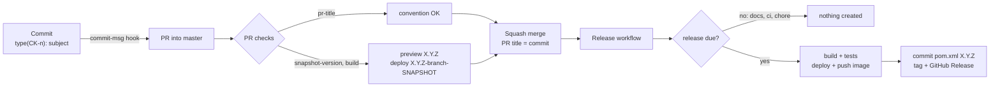
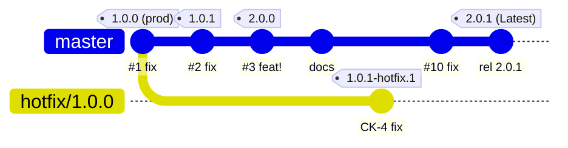
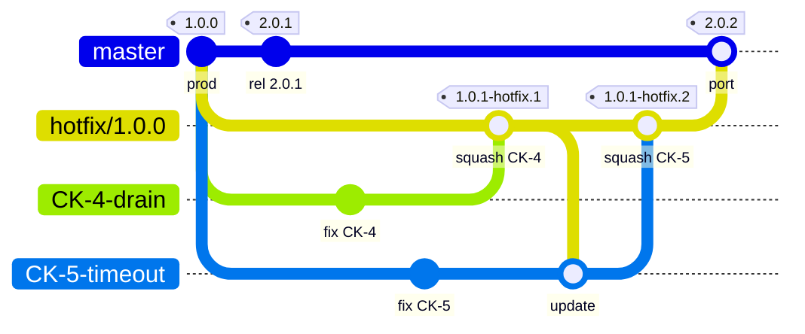
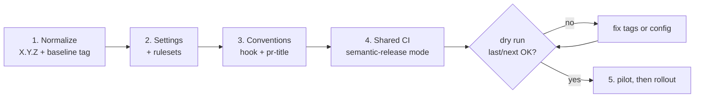

# Proposal: Automated Releases from PR Titles with semantic-release

**Scope:** `avall/avm-<name>` (Maven, branch `master`) · **Status:** proposal for design review · **Date:** 2026-10-28 · **Reference implementation:** [`avall/avm-semantic-release-poc`](https://github.com/avall/avm-semantic-release-poc) · **POC:** [`avall/homelab-poc-semantic-version`](https://github.com/avall/homelab-poc-semantic-version)

---

## 1. Executive Recommendation

**The version is a consequence of what is merged.** Each PR title says what kind of change it is; semantic-release turns the titles merged into `master` into the next `MAJOR.MINOR.PATCH`.

- **Write** commits and PR titles as `<type>(CK-<number>)[!]: <subject>`. A local hook and the `pr-title` check enforce it.
- **Preview** in every PR the version it will release and build it as `<next>-<branch>-SNAPSHOT`, deployed to Nexus `snapshots`.
- **Squash merge** only: the PR title becomes the single commit on `master`, and that commit decides the bump.
- **Release on merge** in one job: calculate the version, build and test, deploy to Nexus `releases`, push the image, commit `pom.xml` as `chore(release): X.Y.Z [skip ci]`, then create the tag and the GitHub Release. The tag comes last, so a failed build never leaves one behind.
- **Hotfix** the version in production on `hotfix/<production tag>`, released on demand by **Run workflow** as `X.Y.(Z+1)-hotfix.N` (GitHub Pre-release, never Latest, no docker `latest`).
- **Read** the version in production from the running service (`/actuator/info`), never from git.

The design is the one proven in the reference repository above (Cinarra runners, real tags, GitHub Releases and `pom.xml` commits). The POC repeats it with two Maven modules, a real `mvn deploy` to a Nexus started with docker compose, and actuator `/actuator/info`.

## 2. Problem Statement

Today a Java service version says nothing about what changed ([Java SemVer RFD](java-semantic-versioning.md) §2):

- **Every release is a PATCH.** The shared Java release pipeline (manual dispatch) runs `versions:set -DremoveSnapshot`, releases, and then `-DnextSnapshot` adds 1 to the last number. It has no release-type input.
- **Hotfixes have no free version.** `master` always takes the next PATCH, and production often runs an older version (production `1.0.0` while `1.0.1`, `1.0.2` and `2.0.0` already exist).
- **8 of 23 Java repositories have no SemVer version:** 3 use `X.Y` and 5 use an integer (`415`).
**Single integer (5):**

| Repo | Version |
|---|---|
| avm-build-tools-mod | `246-SNAPSHOT` |
| avm-dal-mod | `439-SNAPSHOT` |
| avm-kafka-mod | `342-SNAPSHOT` |
| avm-parent-pom | `415-SNAPSHOT` |
| avm-swagger-mod | `530-SNAPSHOT` |
avmX.Y version (3):**

| Repo | Version |
|---|---|
| avm-idm-event-loader | `1.13-SNAPSHOT` |
| avm-job-scheduler | `1.43-SNAPSHOT` |
| avm-profile-mod | `2.22-SNAPSHOT` |

- **Nothing records the change type.** PR titles are Jira keys; 0 of the last 60 merged PRs follow Conventional Commits.
- **Merges are inconsistent.** Squash, merge and rebase are all allowed in some repositories.

## 3. Version Rules

### Commit and PR title convention

```text
<type>(CK-<number>)[!]: <subject>
```

- **type:** one word from the list below. It decides the bump.
- **scope:** the Jira key, required (`CK-0` for work without a ticket, as in the reference).
- **`!`:** breaking change, MAJOR.
- **subject:** imperative and specific; it becomes the release-note line.

| PR title type | Bump | Example |
| --- | --- | --- |
| `fix`, `perf`, `revert` | PATCH `1.2.3 → 1.2.4` | `fix(CK-45): handle empty name` |
| `feat` | MINOR `1.2.3 → 1.3.0` | `feat(CK-123): add hello endpoint` |
| any type with `!` after the scope | MAJOR `1.2.3 → 2.0.0` | `feat(CK-7)!: remove v1 API` |
| `docs`, `ci`, `chore`, `test`, `build`, `refactor` | none | `ci(CK-0): run workflows on micro-k8s runners` |

Rules:

- **The PR title is the only input.** The repository squashes with title = PR title and a blank body, so branch commits and the PR description never reach `master`.
- **`!` is the breaking signal.** Conventional Commits also accepts a `BREAKING CHANGE:` footer, but with a blank squash body a footer in the PR description has no effect on the release. Known gap: the `snapshot-version` preview builds its simulated squash commit from the PR title **and** description, so such a footer raises the preview (MAJOR) but not the real release. Keep breaking changes in the title.
- **The highest bump wins** when one release contains several PRs: `fix` + `feat` + `feat!` gives one MAJOR.
- **`revert` needs a release rule.** The `conventionalcommits` preset only recognizes git's `Revert "..."` header, so the semantic-release configuration maps `revert` to patch; it also maps `perf` explicitly, which the default rules already release as patch (both verified with `@semantic-release/commit-analyzer` 13.0.1). The GitHub "Revert" button titles PRs `Revert "..."`: rename them to `revert(CK-n): <original subject>`.
- **A dependency upgrade that fixes a bug or a vulnerability is a `fix`**, so it releases.
- **Rejected:** `CK-11533`, `fix: handle empty name` (no scope), `feat(auth): add export` (scope is not a Jira key), `breaking(CK-1): remove v1`.

### Checks that enforce it

| Check | What it does |
| --- | --- |
| `commit-msg` hook | Local git hook that rejects a local commit that does not match the pattern; allows `Merge`, `fixup!`, `squash!`, `amend!` and `chore(release):`, ignores `#` comment lines. Local only: a skipped hook is not caught in CI, but only the PR title reaches `master` |
| `pr-title` | Validates the PR title: fixed type list, scope required, scope `CK-\d+` |
| `snapshot-version` | Dry run of semantic-release on the base branch plus the future squash commit; prints "This PR will release `X.Y.Z`" |
| `build` | `versions:set` to `<next>-<branch>-SNAPSHOT`, `mvn deploy` to Nexus `snapshots` with unit and integration tests, docker snapshot image |

`snapshot-version` runs no PR code: it checks out the base commit, so the release configuration comes from the base branch, and the PR is reduced to its commit message.

## 4. Release Workflow



The release runs on every push to `master` (and on demand by **Run workflow** on `master` or `hotfix/X.Y.Z`, with a dry-run option). One job, in this order:

1. **Calculate the version.** semantic-release dry run with the release configuration from `master`. No releasable commit since the last tag: the job stops and nothing is created.
2. **Validate** it against `^[0-9]+\.[0-9]+\.[0-9]+(-hotfix\.[0-9]+)?$`.
3. **Build** with `versions:set -DnewVersion=X.Y.Z -DprocessAllModules=true`, then `mvn clean deploy` to Nexus `releases`.
4. **Push the image** `<service>:X.Y.Z-oci`, `<service>:X.Y.Z` and, from `master` only, `<service>:latest`.
5. **Commit, tag and release.** semantic-release with `@semantic-release/git` commits the `pom.xml` files already set in step 3 as `chore(release): X.Y.Z [skip ci]`, tags that commit and creates the GitHub Release with notes from the PR titles. A last step checks that the published version equals the calculated one.

The job runs in concurrency group `release-<ref>` without cancellation, so releases of a branch run one at a time. `[skip ci]` keeps the release commit from starting another run.

### Why the pom is committed

The team wants developers to open `pom.xml` and see the last release, as they do today. The cost is real and accepted:

| Cost | Detail | How the design lives with it |
| --- | --- | --- |
| A bypass identity | The release pushes to the protected `master`. `GITHUB_TOKEN` can never be a ruleset bypass actor: the UI does not list it, and the API returns 422 "Actor GitHub Actions integration must be part of the ruleset source or owner organization" (personal repository and Free organization) | Secret `PUSH_TO_PROTECTED_BRANCH`, whose owner is in the `master` bypass list: the pattern today's Java release already uses for its version commit |
| Open PRs fall behind | Every release adds a commit to `master` | Keep "Require branches to be up to date" **off** (as in the reference ruleset); otherwise each release forces "Update branch" and a new build on every open PR |
| Upstream advice | The semantic-release [FAQ](https://semantic-release.gitbook.io/semantic-release/support/faq) strongly recommends against committing during a release | The commit holds only the version; the tag and Nexus remain the source of truth for consumers |

No `-SNAPSHOT` is ever committed.

## 5. How Each Item Evolves

Example: last release `2.0.0` on `master`; production runs `1.0.0`; service `avm-hello`, PR branch `feature/CK-12_x`.

| Case | `pom.xml` in git | `pom.xml` in CI | Nexus | Image tags | Git tag | GitHub Release |
| --- | --- | --- | --- | --- | --- | --- |
| PR open, title `fix(CK-12): ...` | `2.0.0` (unchanged) | `2.0.1-feature-CK-12-x-SNAPSHOT` | `snapshots` | `2.0.1-feature-CK-12-x-SNAPSHOT-oci`, `2.0.1-feature-CK-12-x-SNAPSHOT` | none | none |
| PR open, title `docs(CK-12): ...` | `2.0.0` | `2.0.0-feature-CK-12-x-SNAPSHOT` (last release) | `snapshots` | same pattern | none | none |
| Merge `fix` | `2.0.1`, commit `chore(release): 2.0.1 [skip ci]` | `2.0.1` | `releases` | `2.0.1-oci`, `2.0.1`, `latest` | `2.0.1` | `2.0.1`, Latest |
| Merge `feat` | `2.1.0` | `2.1.0` | `releases` | `2.1.0-oci`, `2.1.0`, `latest` | `2.1.0` | `2.1.0`, Latest |
| Merge `feat!` | `3.0.0` | `3.0.0` | `releases` | `3.0.0-oci`, `3.0.0`, `latest` | `3.0.0` | `3.0.0`, Latest |
| Merge `docs`, `ci`, `chore` | unchanged | not built for release | nothing | nothing | none | none |
| Hotfix run on `hotfix/1.0.0` | `1.0.1-hotfix.1` on the hotfix branch only | `1.0.1-hotfix.1` | `releases` | `1.0.1-hotfix.1-oci`, `1.0.1-hotfix.1` (no `latest`) | `1.0.1-hotfix.1` | `Hotfix 1.0.1-hotfix.1 (based on 1.0.0)`, Pre-release |
| Local build | last release, as in git | — | never | — | — | — |

Today's tags stay: `X.Y.Z` (no `v` prefix, `tagFormat: ${version}`), images `<service>:X.Y.Z-oci` and `<service>:X.Y.Z`. The PR image changes from `<service>:<branch>-oci` to `<service>:<snapshot>-oci` and `<service>:<snapshot>`, so it shows which release it previews.

**Never consume** `LATEST`, `RELEASE`, version ranges or docker `latest` in production. Nexus `maven-metadata.xml` reflects the last **deployed** version (a hotfix deployed after `2.0.1` becomes "latest"), and docker tags have no order. Pin exact versions; git tags are the source of truth.

## 6. Snapshots

Most services consume libraries built in other repositories (`avm-proto-buf` is used by 22 repositories, `avm-util-mod` by 19, `avm-libraries` by 13). To test an unmerged library change from another repository, the consumer needs that jar in Nexus.

- **Format:** `<next>-<branch>-SNAPSHOT`, for example `2.1.0-feature-CK-12-x-SNAPSHOT`. `<next>` is what the PR will release; when the PR does not release, it is the last release (`0.0.0` when there is no tag yet).
- **Branch qualifier:** every run of characters outside `[A-Za-z0-9.]` becomes one `-` (dots are kept, so `hotfix/1.0.0` gives `hotfix-1.0.0`), leading and trailing `-` and `.` are removed, at most 60 characters; valid in Maven versions and docker tags. Two PRs that both release `2.1.0` never overwrite each other.
- **When:** only for a PR into `master` or `hotfix/**`, by `build`, on `opened`, `synchronize` (every push), `edited` (title or description) and `reopened`. Opening the PR already builds its first snapshot, so a one-commit branch gets one too. A branch without a PR, a PR into any other base, or a push whose commit carries `[skip ci]` builds no snapshot: the version comes from the PR title, so without a PR there is no bump to predict. `versions:set` runs on the runner's checkout; nothing is committed.
- **Consumer:** sets the dependency to the snapshot while testing and to the released `X.Y.Z` before merging. `maven-enforcer-plugin` with `requireReleaseDeps` in the release build blocks a release with a `-SNAPSHOT` dependency.
- **Cleanup:** a Nexus cleanup policy on `snapshots` (format `maven2`, *last downloaded before 60 days*), run by the task *Admin - Cleanup repositories using their associated policies*, then *Admin - Compact blob store*. Today 611 snapshot poms in Nexus date from 2019.

Today snapshots reach Nexus only as a side effect of a release or a manual `mvn deploy`, and branches publishing the same `x.y.z-SNAPSHOT` overwrite each other.

## 7. Hotfixes

Production deployments are slow, so production usually runs an older version while `master` keeps releasing. An urgent bug in production `1.0.0` must be fixed **without** shipping `1.0.1` or `2.0.0`, which were never validated in production. The hotfix branch is therefore cut from tag `1.0.0`.



The live example of the reference repository: PR #9 (`hotfix/1.0.0` into `master`) stays open while `1.0.1-hotfix.1` is released by **Run workflow**; `master` keeps releasing (`2.0.1`, Latest).

### Steps

```bash
git fetch --tags
git switch -c hotfix/1.0.0 1.0.0            # the version in production
git commit -am "fix(CK-4): drain in-flight requests on shutdown"
git push -u origin hotfix/1.0.0
gh pr create --base master --head hotfix/1.0.0 --title "fix(CK-4): drain in-flight requests on shutdown"
```

1. **Cut** `hotfix/<production tag>` from that tag. The base version is read from the branch name, and the tag must exist.
2. **Fix** with `fix`, `perf` or `revert` commits pushed to the hotfix branch (direct pushes are accepted and run no checks) or merged into it by a PR (which runs `pr-title`, `snapshot-version` and `build`).
3. **Open a PR** from the hotfix branch into `master` and keep it open: its checks show the `master` preview (`2.0.1-hotfix-1.0.0-SNAPSHOT`).
4. **Release** with **Run workflow** on the hotfix branch: first as a dry run, then for real. The run adds `hotfix/X.Y.Z` as a semantic-release prerelease branch (`"prerelease": "hotfix"`) for that run only, computes `1.0.1-hotfix.N`, sets that version in the CI workspace only, builds, deploys, pushes the image without `latest` and creates the tag on the last fix commit and a **Pre-release**. It does **not** commit `pom.xml`: the hotfix branch keeps the base version lines, so its PR into `master` does not conflict on them. Latest stays on the `master` release.
5. **Deploy** `1.0.1-hotfix.N` with the normal, separate deployment pipeline.
6. **Merge** the PR (squash: `master` releases the next PATCH with the fix) or **close** it (`master` is unaffected). Every later hotfix is cumulative: `hotfix.2` contains `hotfix.1`.

### Hotfix guard

The hotfix guard runs in both `snapshot-version` and the release and fails when a hotfix branch would not release `X.Y.(Z+1)-hotfix.N`. The tag-existence check runs only in the release:

| Situation | Computed | Result |
| --- | --- | --- |
| `fix` on `hotfix/1.0.0` | `1.0.1-hotfix.1` | released |
| `feat` or `!` on `hotfix/1.0.0` | `1.1.0-hotfix.1` or `2.0.0-hotfix.1` | rejected: patch-level changes only |
| `master` merged into the branch ("Update branch") | based on `2.0.0` | rejected: the branch contains release `2.0.0` and can no longer be a hotfix of `1.0.0` |
| Branch `hotfix/1.0.9`, no tag `1.0.9` | — | release rejected before the dry run |
| `hotfix/1.0.0` recreated from `1.0.0` or `1.0.1-hotfix.1` after `1.0.1-hotfix.2` was released | `1.0.1-hotfix.1` or `1.0.1-hotfix.2` | rejected before the build: the tag already exists, so the branch must start from the latest hotfix tag `1.0.1-hotfix.2` |

So release every hotfix **before** any "Update branch" of the hotfix PR. A hotfix branch that was deleted (for example by merging its PR) is recreated from the latest hotfix tag of its line, never from the production tag: the line is cumulative.

**Known risk: version ordering.** For SemVer, `1.0.1-hotfix.N` is a pre-release of `1.0.1`, so it sorts **below** `1.0.1`. When `master` has already released `1.0.1`, any tool that compares versions (Maven ranges, Renovate, Dependabot) treats `1.0.1` as newer than the hotfix, although `1.0.1` does not contain the fix. The alternative, semantic-release maintenance branches (`1.0.x`), publishes real patch versions but fails when `master` already holds that number. This design keeps hotfixes from colliding with `master` and accepts the ordering quirk: pin hotfix versions explicitly and never resolve them through version ranges.

### Two hotfixes at the same time on the same tag

Two production bugs on `1.0.0` (CK-4 and CK-5) are fixed in parallel. The branch name is fixed by the rule (`hotfix/<production tag>`), so there is **one** hotfix branch, `hotfix/1.0.0`, and both fixes go into it:

1. Each developer branches from the hotfix branch and opens a PR **into `hotfix/1.0.0`**: `CK-4-drain` → `fix(CK-4): drain in-flight requests on shutdown`, `CK-5-timeout` → `fix(CK-5): raise the client timeout`. The checks run against the hotfix base: `snapshot-version` previews `1.0.1-hotfix.1` and `build` deploys `1.0.1-hotfix.1-CK-4-drain-SNAPSHOT`.
2. CK-4 is squash-merged first. **Run workflow** on `hotfix/1.0.0` releases `1.0.1-hotfix.1` (CK-4); the tag points at the squash commit and no `pom.xml` commit is added.
3. The CK-5 PR is now behind: **Update branch** (from `hotfix/1.0.0`, not `master`, so the guard accepts it), checks again, merge. The next Run workflow releases `1.0.1-hotfix.2` = `1.0.0` + CK-4 + CK-5.
4. Production deploys `1.0.1-hotfix.2`; `1.0.1-hotfix.1` is skipped or replaced.
5. The single PR `hotfix/1.0.0` → `master` carries both fixes; `master` releases the next PATCH (`2.0.2`).



Hotfix tags point at the squash commits: the hotfix branch gets no `chore(release)` commit. `update` is the "Update branch" of the CK-5 PR; `port` is the squash of the PR `hotfix/1.0.0` → `master`.

| Item | After CK-4 release | After CK-5 release |
| --- | --- | --- |
| `pom.xml` on `hotfix/1.0.0` (git) | `1.0.0` (unchanged) | `1.0.0` (unchanged) |
| `pom.xml` in CI | `1.0.1-hotfix.1` | `1.0.1-hotfix.2` |
| Nexus `releases` | `1.0.1-hotfix.1` | `1.0.1-hotfix.1`, `1.0.1-hotfix.2` |
| Image tags | `1.0.1-hotfix.1`, `1.0.1-hotfix.1-oci` | `1.0.1-hotfix.2`, `1.0.1-hotfix.2-oci` (never `latest`) |
| Git tag / GitHub Release | `1.0.1-hotfix.1`, Pre-release | `1.0.1-hotfix.2`, Pre-release (Latest stays on `master`) |

- **No race:** releases of one branch are queued without cancellation, so two runs on the same hotfix branch run one after the other.
- **Release after each merge** if each fix needs its own version; merging both before one run releases them together as `1.0.1-hotfix.1`.
- **B without A** is not possible once A is on the branch: revert A with a `revert(CK-4): ...` PR into the hotfix branch.
- **Direct pushes** to the hotfix branch run no checks; with two developers, use PRs and pull before pushing, because every release adds a `chore(release)` commit.
- **Port to `master`:** the squash has one title, so name both keys in it or port each fix with its own cherry-pick PR.

### Why `1.0.1-hotfix.1`

In SemVer (§11) a pre-release sorts before its plain version (`1.0.0-rc.1 < 1.0.0`). `1.0.0-hotfix.1` would look older than production, `1.0.1` is taken, and `1.0.0.1` is not SemVer. `1.0.0 < 1.0.1-hotfix.1 < 1.0.1-hotfix.2 < 1.0.1` means exactly "1.0.0 plus fixes".

| Topic | Behaviour | Consequence |
| --- | --- | --- |
| SemVer meaning (§9) | A pre-release "indicates that the version is unstable" | Accepted; the GitHub Release is marked Pre-release and its title names the base |
| `1.0.1` sorts above the hotfix | It lacks the fix | Never "upgrade" a hotfix to `1.0.1` or `1.0.2`; the next production deploy is a `master` release that contains the fix |
| Maven ordering | `1.0.1-hotfix.10 > 1.0.1` (unknown qualifier sorts after the release) | Irrelevant for services; libraries get a normal PATCH from `master` |
| semantic-release maintenance branches (`1.0.x`) | Would compute `1.0.1`, which already exists with other code | Not usable when production lags several releases behind |
| Workflows at the tag | A hotfix runs the workflows as they were at its tag | Tags older than the rollout cannot run the hotfix release; cut hotfixes only from tags released by the new flow |

## 8. GitHub Configuration

| Setting | Value | Why |
| --- | --- | --- |
| Merge methods | Squash only; merge commits and rebase off | One commit per PR reaches `master` |
| Squash commit | `squash_merge_commit_title=PR_TITLE`, `squash_merge_commit_message=BLANK` | The PR title is the only input. GitHub still appends `Co-authored-by:` and `Signed-off-by:` trailers, which do not affect the bump |
| `delete_branch_on_merge` | on | Feature branches disappear; hotfix branches are kept by not merging them until the hotfix ends |
| `master` ruleset | Require a PR, allowed method squash, required checks `pr-title` and `build` (`snapshot-version` runs on every PR but is not required), block force push and deletion, "up to date" off | No commit reaches `master` without a valid title and a green build |
| Bypass list of the `master` ruleset | The owner of `PUSH_TO_PROTECTED_BRANCH` only (mode *always*) | Only the release commit bypasses the PR rule |
| `hotfix/**` | No PR requirement; direct pushes accepted | Hotfix commits land without a bypass; the hotfix release itself pushes only its tag |
| Tag ruleset on `*.*.*` | Restrict update and deletion | A released tag never moves. No creation rule: the release creates tags |
| [Immutable releases](https://docs.github.com/en/code-security/supply-chain-security/understanding-your-software-supply-chain/immutable-releases) | on (verify in the pilot) | Release and tag cannot be changed after publication |

**Bootstrap order** for each repository: add the release automation first, open one PR so every required check reports once, then create the rulesets. A required check that never reported blocks every PR.

**At scale (GitHub Enterprise):** a template repository with the release automation; a custom property `release-flow = semantic-release`; [organization rulesets](https://docs.github.com/en/organizations/managing-organization-settings/creating-rulesets-for-repositories-in-your-organization) targeting that property; Terraform (`integrations/github`) for merge settings, which are repository settings and not ruleset rules.

**Secrets and permissions:** `GITHUB_TOKEN` with write access to contents for dry runs (semantic-release verifies push access even in dry-run); `PUSH_TO_PROTECTED_BRANCH` only in the final commit, tag and release step. A fork PR receives a read-only token and fails `snapshot-version`.

## 9. Which Version Runs in Production

The pom now shows the last release, and the newest GitHub Release is not necessarily what production runs: deployments are slow and separate. Read the version from the running service or from the deployment.

| # | Source | What it shows | Notes |
| --- | --- | --- | --- |
| 1 | **`GET /actuator/info`** | `build.version` (the released pom version), `git.branch`, `git.commit.id`, `git.commit.time` | The running process: the source of truth. Needs `spring-boot-starter-actuator`, the `build-info` goal (`<time>off</time>`) and `git-commit-id-maven-plugin` (`failOnNoGitDirectory=false`); expose only `health` and `info`. Implemented in the POC |
| 2 | **avm-dashboard** | Services and deployed versions | Existing tool; it should read #1 so it shows the running build |
| 3 | **Deployment declarations in git** | CMS: `image:` in `avm-infra/<env>/services/<service>/<host-group>/metadata.yml`. CCS: `docker_tag` in `avm-config/<service>/<env>/deployment.json` | Desired state; differs from #1 during or after a failed deployment |
| 4 | **Runtime platform** | Image tag of the running container | Operator access needed; tag `<service>:<version>-oci` |
| 5 | **[GitHub Deployments](https://docs.github.com/en/rest/deployments/deployments)** (new) | "production: `2.1.0`" on the repository page | The deploy pipeline records a deployment for `production`; native, keeps history per environment |
| 6 | **Production badge** (new) | Badge in the README | Must be generated by the pipeline from #1 (shields.io cannot read private repositories); rendering in a private README not verified |

**Recommendation:** #1 is the source of truth and #2 consumes it; for people browsing GitHub, prefer #5 over #6.

## 10. Migration from Today's Process



| Step | What | Done when |
| --- | --- | --- |
| 1. Normalize | Repositories without `X.Y.Z`: `X.Y` becomes `X.Y.0`, `N` becomes `N.0.0` (RFD §9.4). Set the pom to the last release (no `-SNAPSHOT`) and create a baseline tag on the last release commit | The last tag is valid SemVer and equals the pom |
| 2. Settings | §8 | Only squash with title = PR title is possible |
| 3. Conventions | Hook and `pr-title`; titles change from `CK-11533` to `fix(CK-11533): handle null carrier id` | Every new PR passes |
| 4. Workflows | See below | `dry_run` shows the right last and next version |
| 5. Pilot | One `X.Y.Z` service: a `fix` PR, a `feat` PR and one hotfix; then team by team | The first three releases match their titles |

**Why this order:** semantic-release finds the last release from tags matching `tagFormat`. With no valid SemVer tag (`415`, `1.43`) it proposes `1.0.0`, which in an integer repository is a regression (Maven orders `1.0.0` below `415`).

**Changes in the shared Java CI** (the reference emulates the current PR and release pipelines step by step):

| Today | Proposed |
| --- | --- |
| PR build: version set to the branch name, image `<service>:<branch>-oci` on label "Ready for QA" | Preview of the next version + `versions:set <next>-<branch>-SNAPSHOT`, `mvn deploy` to `snapshots`; images `<service>:<snapshot>-oci` and `<service>:<snapshot>` (keep the label trigger for the image push) |
| Release: manual dispatch, `-DremoveSnapshot` | Automatic on push to `master`; version computed by semantic-release; `versions:set` called directly |
| `-DnextSnapshot` and a version commit | `@semantic-release/git` commits `X.Y.Z` with the same protected-branch secret |
| GitHub Release created separately | `@semantic-release/github` (notes from PR titles) |
| — | Manual **Run workflow** on `hotfix/X.Y.Z` |

Keep the old path selectable (`release_type: legacy`) until each repository migrates.

## 11. Risks and Trade-offs

| # | Risk | Mitigation |
| --- | --- | --- |
| 1 | A wrong title gives the wrong bump (a breaking change titled `feat:`) | "Breaking change?" checkbox in the PR template; the preview in `snapshot-version`; fix forward with a new release |
| 2 | Whoever merges edits the title in the merge dialog | Not blocked in the reference. Optional hardening: a guard step that compares each new `master` commit subject with its PR title (GitHub API "List pull requests associated with a commit") and stops the release on a mismatch |
| 3 | The bypass identity can push anything to `master` | One dedicated account, secret used in one step only, rotated; audit pushes that are not `chore(release):` |
| 4 | Release commit makes open PRs fall behind | "Up to date" off; a [merge queue](https://docs.github.com/en/repositories/configuring-branches-and-merges-in-your-repository/configuring-pull-request-merges/managing-a-merge-queue) if the PR queue grows |
| 5 | `master` moves between version calculation and publication | "Verify published version" fails the run; re-run the workflow |
| 6 | Hotfix releases no longer commit `pom.xml`, but a hotfix branch cut from a tag released before that change still commits the versions, and its PR into `master` conflicts on them | Resolve keeping `master`'s version, or port the fix commits to `master` with a cherry-pick PR; release the last hotfix first |
| 7 | `1.0.1` is deployed over `1.0.1-hotfix.N` and the bug returns | §7 rule; the hotfix release title names its base |
| 8 | Tag, release and commit now use a personal token, so tag and release events can trigger other workflows | Deployments do not listen to release events; `[skip ci]` on the commit |
| 9 | Actions referenced by version tag can change under the same tag | Team choice for readability; pin npm versions (`semantic-release@25.0.9`, `conventional-changelog-conventionalcommits@9.3.1`, not 10.x, which needs a newer changelog writer); review Dependabot updates |
| 10 | Dependabot PR titles have no Jira key | Set `commit-message.prefix` with a key such as `build(CK-0)`, or exempt `dependabot[bot]` in `pr-title` |

## 12. Implementation Plan

- [ ] Settings and rulesets (§8) in the pilot repository, including the bypass account and `PUSH_TO_PROTECTED_BRANCH`.
- [ ] Release automation, hook and semantic-release configuration from the reference into the shared Java CI.
- [ ] PR pipeline: version preview and snapshot deploy. Release pipeline: semantic-release mode with real deploy and push.
- [ ] Actuator `info` with `build-info` and `git-commit-id` in every service; avm-dashboard reads it; deploy pipeline records a GitHub Deployment.
- [ ] Nexus: 60-day cleanup policy on `snapshots`; `requireReleaseDeps` in release builds.
- [ ] Normalize versions and baseline tags (§10), then `dry_run` on `master`.
- [ ] Pilot: `fix` gives a PATCH, `feat` a MINOR, `docs` nothing; one hotfix released as `X.Y.(Z+1)-hotfix.1` (Pre-release, Latest unchanged).
- [ ] Rollout team by team; remove the legacy path.

**Success:** every tag maps to merged PRs; no version is edited by hand; the artifact, the image, the tag and `/actuator/info` show the same version.

## 13. References

- **Standards:** [Semantic Versioning 2.0.0](https://semver.org/spec/v2.0.0.html) · [Conventional Commits 1.0.0](https://www.conventionalcommits.org/en/v1.0.0/) · [Maven version order](https://maven.apache.org/pom.html) · [Java SemVer RFD](java-semantic-versioning.md)
- **semantic-release:** [docs](https://semantic-release.gitbook.io/semantic-release/) · [FAQ](https://semantic-release.gitbook.io/semantic-release/support/faq) · [workflow configuration](https://semantic-release.gitbook.io/semantic-release/usage/workflow-configuration) · [pre-releases](https://semantic-release.gitbook.io/semantic-release/recipes/release-workflow/pre-releases) · [maintenance releases](https://semantic-release.gitbook.io/semantic-release/recipes/release-workflow/maintenance-releases) · [@semantic-release/git](https://github.com/semantic-release/git)
- **GitHub:** [about rulesets](https://docs.github.com/en/repositories/configuring-branches-and-merges-in-your-repository/managing-rulesets/about-rulesets) · [available rules](https://docs.github.com/en/repositories/configuring-branches-and-merges-in-your-repository/managing-rulesets/available-rules-for-rulesets) · [organization rulesets](https://docs.github.com/en/organizations/managing-organization-settings/creating-rulesets-for-repositories-in-your-organization) · [squash merge settings](https://docs.github.com/en/repositories/configuring-branches-and-merges-in-your-repository/configuring-pull-request-merges/configuring-commit-squashing-for-pull-requests) · [immutable releases](https://docs.github.com/en/code-security/supply-chain-security/understanding-your-software-supply-chain/immutable-releases) · [Actions secure use](https://docs.github.com/en/actions/reference/security/secure-use) · [GITHUB_TOKEN](https://docs.github.com/en/actions/concepts/security/github_token) · [`pull_request_target` changes (2025-12-08)](https://github.blog/changelog/2025-11-07-actions-pull_request_target-and-environment-branch-protections-changes/) · [Deployments API](https://docs.github.com/en/rest/deployments/deployments)
- **Maven and Nexus:** [versions:set](https://www.mojohaus.org/versions/versions-maven-plugin/set-mojo.html) · [maven-deploy-plugin](https://maven.apache.org/plugins/maven-deploy-plugin/) · [Nexus Maven repositories](https://help.sonatype.com/en/maven-repositories.html) · [Nexus cleanup policies](https://help.sonatype.com/en/cleanup-policies.html)
- **Spring Boot:** [actuator endpoints (`info`)](https://docs.spring.io/spring-boot/reference/actuator/endpoints.html) · [`build-info` goal](https://docs.spring.io/spring-boot/maven-plugin/build-info.html)
- **Industry practice:** [git-flow, hotfix branches (nvie.com)](https://nvie.com/posts/a-successful-git-branching-model/) · [Kubernetes patch releases](https://kubernetes.io/releases/patch-releases/) · [Google SRE book: Release Engineering](https://sre.google/sre-book/release-engineering/) · [Martin Fowler: Continuous Integration](https://martinfowler.com/articles/continuousIntegration.html)

---

## Appendix A. Key Configuration

The implementation is in the [reference repository](https://github.com/avall/homelab-poc-semantic-version) and the POC.

**semantic-release configuration**: the release and hotfix names come from the branch type.

```json
{
  "branches": ["master"],
  "tagFormat": "${version}",
  "plugins": [
    ["@semantic-release/commit-analyzer", {
      "preset": "conventionalcommits",
      "releaseRules": [
        { "type": "perf", "release": "patch" },
        { "type": "revert", "release": "patch" }
      ]
    }],
    ["@semantic-release/release-notes-generator", { "preset": "conventionalcommits" }],
    ["@semantic-release/github", {
      "successComment": false,
      "failComment": false,
      "releasedLabels": false,
      "releaseNameTemplate": "<% if (branch.type === 'prerelease' && branch.prerelease === 'hotfix') { %>Hotfix <%= nextRelease.version %> (based on <%= branch.name.replace('hotfix/', '') %>)<% } else { %><%= nextRelease.version %><% } %>",
      "releaseBodyTemplate": "<% if (branch.type === 'prerelease' && branch.prerelease === 'hotfix') { %>> **Hotfix** for production version <%= branch.name.replace('hotfix/', '') %>, built from tag <%= branch.name.replace('hotfix/', '') %> without later changes. Not marked as latest.\n\n<% } %><%= nextRelease.notes %>"
    }]
  ]
}
```

On a `hotfix/X.Y.Z` run, the release sets `"branches": ["master", {"name": "hotfix/X.Y.Z", "prerelease": "hotfix"}]` for that run only.

**Release commit of `pom.xml`**: for the publishing run only, `@semantic-release/git` is added before the GitHub plugin with `"assets": ["pom.xml"]` and `"message": "chore(release): ${nextRelease.version} [skip ci]"`, and it runs with the protected-branch token. For a multi-module build (the homelab POC), `assets` lists every module pom (for example `["pom.xml", "*/pom.xml"]`).

**Tool versions:** `semantic-release` 25.0.9, `conventional-changelog-conventionalcommits` 9.3.1, `@semantic-release/git` 11.0.1.
